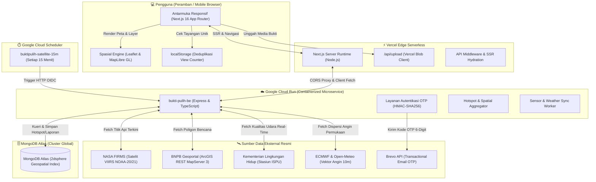

# 🌿 Bukti Pulih — Frontend Web Application

> **Platform Web Partisipatif untuk Pemantauan Karhutla Real-Time & Dokumentasi Pemulihan Lingkungan**  
> *Karya Web Development Competition UINIC 8.0 — Tim Fomo Kemenangan*

[](https://nextjs.org/)
[](https://react.dev/)
[](https://www.typescriptlang.org/)
[](https://bukti-pulih.vercel.app)
[](https://bukti-pulih-be-1049969018442.asia-southeast2.run.app/health)

---

## 🔗 Keterhubungan dengan Backend Service

Aplikasi frontend ini terhubung secara langsung dengan modul backend microservice mandiri:
* **Repositori Backend Lokal**: [`../bukti-pulih-be`](../bukti-pulih-be)
* **Layanan Backend Live (Google Cloud Run)**: [`https://bukti-pulih-be-1049969018442.asia-southeast2.run.app`](https://bukti-pulih-be-1049969018442.asia-southeast2.run.app)
* **Health Check Endpoint**: [`/health`](https://bukti-pulih-be-1049969018442.asia-southeast2.run.app/health)

Frontend mengonsumsi REST API dari backend Cloud Run untuk data titik panas satelit terverifikasi, sensor kualitas udara, data poligon petak pemulihan, orkestrasi autentikasi email OTP, serta pelaporan bukti geolokasi warga.

---

## 🏛️ Arsitektur Sistem (Mermaid Diagram)



---

## 🛠️ Tech Stack & Pustaka Utama

* **Framework Inti**: [Next.js 16 (v16.4.0)](https://nextjs.org/) dengan App Router Architecture
* **Library Komponen**: [React 19 (v19.3.0)](https://react.dev/) & React DOM
* **Bahasa**: [TypeScript 5](https://www.typescriptlang.org/) dengan tipe data ketat
* **Styling**: Vanilla CSS murni dengan pendekatan **Atomic Design Tokens** (tanpa dependensi utility TailwindCSS yang berat)
* **Mesin Pemetaan**:
  * [Leaflet (v1.9.4)](https://leafletjs.com/) dengan modul klusterisasi `leaflet.markercluster`
  * [MapLibre GL (v6.16.0)](https://maplibre.org/) untuk akselerasi WebGL vektor spasial
  * [Google Maps JS API Loader](https://www.npmjs.com/package/@googlemaps/js-api-loader) untuk tampilan topografi dan street view
* **Animasi & Interaktivitas**: [Motion (v14.6.0)](https://motion.dev/) & Web Animations API
* **Penyimpanan Media Bukti**: [@vercel/blob (v2.8.1)](https://vercel.com/docs/storage/vercel-blob) untuk unggah foto/video hingga 50 MB
* **Deployment**: Vercel Edge Serverless Network dengan Global CDN

---

## 🛰️ Sumber Data Eksternal (Data Sources)

BuktiPulih mengintegrasikan 5 sumber data terbuka resmi skala nasional dan global:

1. **NASA FIRMS (Fire Information for Resource Management System)**  
   * **Sensor**: Satelit Suomi NPP, NOAA-20, dan NOAA-21 (VIIRS 375m active fire data).  
   * **Fungsi**: Titik koordinat panas (hotspot) teraktual dengan tingkat kepercayaan tinggi (*high/nominal confidence*).
2. **BNPB (Badan Nasional Penanggulangan Bencana)**  
   * **Endpoint**: `https://gis.bnpb.go.id/server/rest/services/2026_karhutla/mv_prov_karhutla_2026/MapServer/3/query`  
   * **Fungsi**: Data batas administrasi provinsi terdampak karhutla, riwayat bencana, dan status tanggap darurat nasional.
3. **Kementerian Lingkungan Hidup / BPLH (ISPU)**  
   * **Fungsi**: Indeks Standar Pencemar Udara (ISPU) dan konsentrasi partikulat halus PM2.5 real-time dari stasiun pemantau resmi.
4. **ECMWF & Open-Meteo Atmospheric Dispersion Model**  
   * **Fungsi**: Vektor arah dan kecepatan angin permukaan 10 meter untuk memodelkan lintasan penyebaran kabut asap secara dinamis.
5. **Brevo Transactional Email API**  
   * **Fungsi**: Gateway pengiriman kode OTP 6-digit berkeamanan tinggi untuk autentikasi pelaporan warga tanpa beban mengingat kata sandi.

---

## ✨ Fitur Unggulan

1. **Peta Interaktif Hotspot & Dispersi Angin Real-Time**  
   Visualisasi titik api satelit NASA FIRMS yang tersinkronisasi otomatis setiap 15 menit dipadukan dengan simulasi aliran angin ECMWF.
2. **Dasbor Pemulihan Lahan & Komparasi Before-After**  
   Penelusuran petak restorasi gambut dengan data persentase bibit hidup, tinggi muka air tanah (TMAT), dan slider foto kronologis.
3. **Pelaporan Bukti Partisipatif (Community-Based Reporting)**  
   Warga dan relawan dapat mengunggah hingga 5 berkas foto/video lapangan (hingga 50 MB) bergeolokasi GPS dan terverifikasi.
4. **Ruang Suara Hijau (Forum Interaktif & Auto-Complete Pencarian Wilayah)**  
   Pencarian wilayah cerdas dengan custom hook `useRegionSuggestions` serta *real-time view counter* dengan deduplikasi `localStorage`.
5. **Responsivitas & Kontrol Mobile Fluid**  
   Kontrol peta selebar 100% fluid, tombol zoom proporsional 48px, dan eliminasi pemotongan horizontal pada peramban mobile Safari iOS.
6. **Autentikasi Aman Passwordless OTP**  
   Pendaftaran dan login instan dengan kode verifikasi numerik 6 digit berbatas waktu (10 menit) terenkripsi HMAC-SHA256.

---

## 📂 Struktur Direktori Proyek

```text
BuktiPulih/
├── public/                 # Aset statis, ikon, vektor logo, dan video intro tunas
├── src/
│   ├── app/                # Next.js 16 App Router
│   │   ├── api/            # Route handlers (upload media Vercel Blob)
│   │   ├── layout.tsx      # Root layout dengan font Plus Jakarta Sans
│   │   ├── page.tsx        # Entry point halaman utama
│   │   └── globals.css     # Design tokens atomik dan styling lanskap footer
│   ├── components/         # Komponen UI Modular
│   │   ├── Map/            # RecoveryMap, MapBoundsHandler, kontrol cuaca/satelit
│   │   ├── Forum/          # ForumFeed, ForumPostCard, CreatePostModal
│   │   ├── Articles/       # ArticlesFeed, ArticleReaderModal
│   │   └── Layout/         # HeaderNav, PortalClient, Footer scenery
│   ├── hooks/              # Custom React Hooks
│   │   ├── useRegionSuggestions.ts  # Auto-complete pencarian wilayah
│   │   ├── useForumPosts.ts         # Sinkronisasi kiriman komunitas
│   │   └── useHazardData.ts         # Konsumsi layer satelit & cuaca
│   └── lib/                # Utilitas & Penyimpanan Klien
│       ├── forumStorage.ts          # Deduplikasi tayangan (view counter)
│       └── utils.ts                 # Sanitasi dan pemformatan tanggal
├── tests/                  # Pengujian unit data beranda
├── package.json            # Konfigurasi dependensi dan skrip
└── tsconfig.json           # Konfigurasi TypeScript
```

---

## 🚀 Panduan Menjalankan Secara Lokal

### Prasyarat
* [Node.js](https://nodejs.org/) versi `>= 18.17.0` (disarankan `>= 20.x`)
* [npm](https://www.npmjs.com/) versi `>= 9.x`

### 1. Instalasi Dependensi
```bash
cd BuktiPulih
npm install
```

### 2. Konfigurasi Environment Variables
Buat berkas `.env.local` pada direktori root `BuktiPulih/`:
```env
# Koneksi Backend Cloud Run
NEXT_PUBLIC_API_URL=https://bukti-pulih-be-1049969018442.asia-southeast2.run.app
# atau untuk pengujian lokal:
# NEXT_PUBLIC_API_URL=http://localhost:5000

# Vercel Blob Storage Token (Opsional untuk pengujian upload berkas)
BLOB_READ_WRITE_TOKEN=your_vercel_blob_token_here
```

### 3. Menjalankan Server Pengembangan
```bash
npm run dev
```
Buka browser dan akses [http://localhost:3000](http://localhost:3000).

### 4. Pemeriksaan Kualitas & Build Produksi
```bash
# Validasi tipe data TypeScript tanpa compile
npx tsc --noEmit

# Validasi build produksi Next.js
npm run build
```

---

## 📄 Lisensi & Hak Cipta

Proyek ini dikembangkan oleh **Tim Fomo Kemenangan** untuk **Web Development Competition UINIC 8.0 (2026)**. Seluruh hak cipta dilindungi undang-undang.
