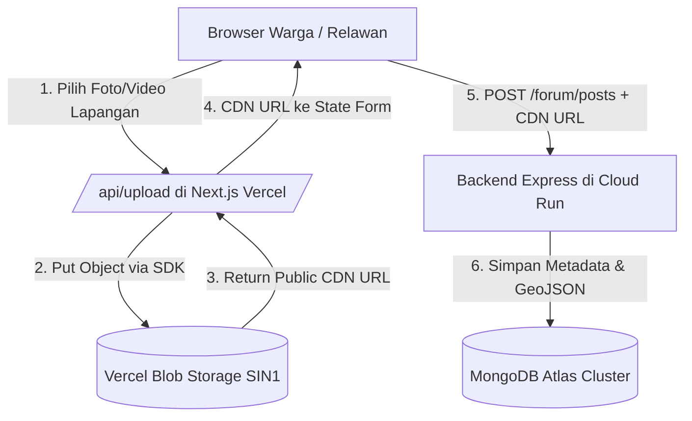

# Panduan Lengkap Deployment BuktiPulih: Vercel (Frontend + Blob) & Google Cloud Run (Backend)

Dokumen ini memandu proses deployment arsitektur **Hybrid Decoupled**:
- **Frontend & Storage**: Next.js App Router + Vercel Blob Storage di [Vercel](https://vercel.com).
- **Backend API**: Express.js + Mongoose di [Google Cloud Run](https://cloud.google.com/run) (Region Jakarta `asia-southeast2` atau Singapore `asia-southeast1`).
- **Database**: MongoDB Atlas Cluster.

---

## 1. Arsitektur Alur Data (Hybrid Decoupled)



### Keunggulan Arsitektur:
1. **Hemat RAM & Kuota Cloud Run**: Kontainer Cloud Run tidak memproses *multipart file upload* berat dalam memori (Cloud Run gratis tier 512MB/1GB).
2. **Zero-Latency CDN**: Vercel Blob berada di region `SIN1` (Singapura), terdistribusi global lewat CDN Vercel.
3. **CORS Terlindungi**: Endpoint `/api/upload` berada di origin yang sama dengan frontend Next.js, bebas kendala CORS peramban.

---

## 2. Langkah 1: Deployment Frontend ke Vercel

### 2.1 Konfigurasi Environment Variables di Vercel Dashboard
Buka [Vercel Dashboard](https://vercel.com) -> pilih proyek frontend atau buat New Project -> **Settings** -> **Environment Variables**:

| Variable Key | Value | Keterangan |
| :--- | :--- | :--- |
| `BLOB_READ_WRITE_TOKEN` | `vercel_blob_rw_ft4X3aHXwAfMVfVv_itOs9AUZvtcoUc1RKk9qGxYA8myDW2` | Token akses read/write Vercel Blob |
| `Karhutla_STORE_ID` | `store_ft4X3aHXwAfMVfVv` | Store ID Vercel Blob |
| `NEXT_PUBLIC_API_URL` | `https://bukti-pulih-be-xxxx-as.a.run.app/api/v1` | URL Backend Cloud Run (diperbarui setelah langkah 3) |

### 2.2 Cara Deploy ke Vercel

#### Pilihan A: Melalui Vercel CLI (Direkomendasikan dari Terminal)
Jalankan di WSL pada direktori frontend:
```bash
cd /home/vereniaes/project/uinic/BuktiPulih
npx vercel
```
*Ikuti petunjuk di terminal (pilih scope akun, link to existing project / buat baru, lalu deploy).*
Untuk deployment produksi:
```bash
npx vercel --prod
```

#### Pilihan B: Melalui Git Mundane (GitHub / GitLab)
1. Lakukan `git add`, `git commit`, dan `git push` repository ke GitHub (dilakukan oleh mundane/user).
2. Di Vercel Dashboard -> **Add New Project** -> Import repository GitHub `BuktiPulih`.
3. Pasang 3 variabel di tabel 2.1, lalu klik **Deploy**.

---

## 3. Langkah 2: Persiapan MongoDB Atlas untuk Cloud Run

Sebelum deploy backend ke Cloud Run, pastikan IP Cloud Run dapat mengakses MongoDB Atlas:
1. Masuk ke [MongoDB Atlas Console](https://cloud.mongodb.com/).
2. Buka menu **Security** -> **Network Access**.
3. Pastikan terdapat entri IP:
   - **IP Address**: `0.0.0.0/0` (Allow access from anywhere).
   - *Catatan: Cloud Run menggunakan IP keluar (egress) dinamis dari Google Cloud, sehingga membutuhkan aturan 0.0.0.0/0 dengan proteksi password pengguna yang kuat.*
4. Salin URI koneksi MongoDB Anda (contoh):
   ```
   mongodb+srv://vereniaes:<PASSWORD>@ac-xsplwf5.it0asbc.mongodb.net/buktipulih_db?retryWrites=true&w=majority
   ```

---

## 4. Langkah 3: Deployment Backend Express ke Google Cloud Run

Backend `bukti-pulih-be` telah dilengkapi `Dockerfile` multi-stage Node 20 produksi minimal.

### 4.1 Login dan Konfigurasi GCP CLI
Pastikan gcloud CLI telah terpasang dan login:
```bash
gcloud auth login
gcloud config set project buktipulih-uinic # atau nama project GCP Anda
```

### 4.2 Deploy Menggunakan Cloud Build & Cloud Run
Jalankan perintah berikut di direktori backend:
```bash
cd /home/vereniaes/project/uinic/bukti-pulih-be

gcloud run deploy bukti-pulih-be \
  --source . \
  --region asia-southeast2 \
  --platform managed \
  --allow-unauthenticated \
  --port 8080 \
  --memory 512Mi \
  --cpu 1 \
  --min-instances 0 \
  --max-instances 2 \
  --set-env-vars "\
NODE_ENV=production,\
PORT=8080,\
MONGODB_URI=mongodb+srv://vereniaes:<PASSWORD>@ac-xsplwf5.it0asbc.mongodb.net/buktipulih_db?retryWrites=true&w=majority,\
JWT_SECRET=buktipulih_prod_secret_jwt_key_2026,\
COOKIE_SECRET=buktipulih_cookie_prod_secret_2026,\
CORS_ORIGIN=https://buktipulih.vercel.app,https://express-js-on-vercel.vercel.app"
```

*Catatan: Parameter `--min-instances 0` memastikan biaya Rp 0 saat server tidak menerima permintaan (Free Tier).*

### 4.3 Menguji Hasil Deploy Cloud Run
Setelah deploy selesai, Cloud Run akan mencetak URL layanan (contoh: `https://bukti-pulih-be-xxxx-as.a.run.app`).
Uji endpoint kesehatan:
```bash
curl https://bukti-pulih-be-xxxx-as.a.run.app/health
# Respons yang diharapkan: {"status":"healthy","service":"bukti-pulih-be",...}
```

---

## 5. Langkah 4: Sinkronisasi URL Backend ke Vercel Frontend

Setelah URL Cloud Run didapatkan:
1. Buka kembali [Vercel Dashboard](https://vercel.com) proyek `BuktiPulih`.
2. Buka **Settings** -> **Environment Variables**.
3. Perbarui `NEXT_PUBLIC_API_URL` dengan:
   ```
   https://bukti-pulih-be-xxxx-as.a.run.app/api/v1
   ```
4. Lakukan **Redeploy** di Vercel agar variabel lingkungan baru diterapkan ke bundle frontend.

---

## 6. Verifikasi Akhir
1. Buka situs Vercel Anda di peramban (`https://buktipulih.vercel.app`).
2. Masuk ke tab **Forum Pulih Warga**.
3. Klik tombol `+ posting bukti`.
4. Unggah foto nyata dari perangkat -> foto akan terunggah langsung ke Vercel Blob (`https://...public.blob.vercel-storage.com/...`).
5. Kirim catatan -> postingan tersimpan dan muncul di *feed* Tumblr masonry secara instan.
