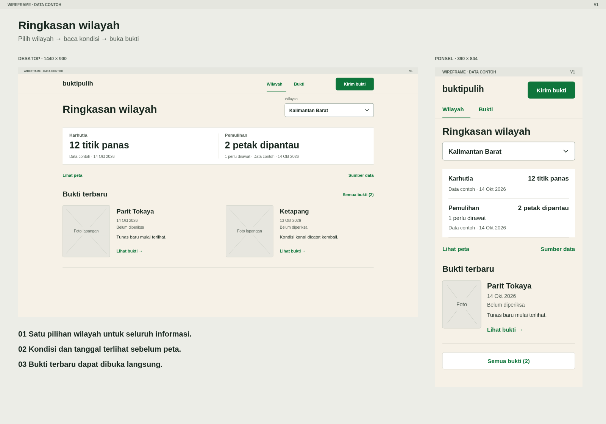

# Wireframe - ringkasan wilayah

Rancangan ini menunjukkan urutan informasi BuktiPulih pada desktop dan ponsel.

Versi: 1. Tanggal: 17 Oktober 2026. Dasar: [BRD](../../brd-ringkasan-wilayah.md) dan [audit](../../../knowledge/ui-ux-audit-2026-10-17.md). Pengguna memilih pembuatan wireframe melalui `/grillme`; persetujuan implementasi belum diberikan.

## Pratinjau

| Keadaan | Desktop 1440 × 900 | Ponsel 390 × 844 |
|---|---|---|
| Semua wilayah | [PNG](desktop-semua-wilayah.png) · [SVG](desktop-semua-wilayah.svg) | [PNG](mobile-semua-wilayah.png) · [SVG](mobile-semua-wilayah.svg) |
| Kalimantan Barat dipilih | [PNG](desktop-wilayah.png) · [SVG](desktop-wilayah.svg) | [PNG](mobile-wilayah.png) · [SVG](mobile-wilayah.svg) |
| Wilayah tanpa data | [PNG](desktop-tanpa-data.png) · [SVG](desktop-tanpa-data.svg) | [PNG](mobile-tanpa-data.png) · [SVG](mobile-tanpa-data.svg) |

SVG dapat diedit sebagai vektor. PNG disediakan untuk ditinjau dan dibagikan. Kedua format merupakan gambar statis; tombol menggambarkan tujuan interaksi, belum dapat diklik.

## Urutan informasi

1. Pilih wilayah dari daftar atau pemilih wilayah.
2. Baca jumlah titik panas, petak yang dipantau, kondisi pemulihan, dan tanggal data.
3. Buka bukti terbaru untuk memeriksa foto serta catatan.
4. Buka peta atau sumber jika diperlukan.

Pada desktop, daftar awal berbentuk tabel ringan. Pada ponsel, setiap wilayah menjadi satu baris besar dengan informasi yang sama. Tiga wilayah ditampilkan sebagai sampel susunan; cakupan proyek lainnya tetap mengikuti taksonomi wilayah yang sudah ada.

Halaman wilayah menampilkan dua bagian ringkasan dalam satu bidang, kemudian bukti. Pada ponsel, satu bukti terbaru ditampilkan dan `Semua bukti` membuka daftar lengkap. Desktop menampilkan dua bukti terbaru. Urutan berdasarkan tanggal pengamatan, bukan popularitas.

## Tujuan kontrol

| Kontrol | Perilaku saat diimplementasikan |
|---|---|
| Wilayah | Kembali ke ringkasan; pilihan wilayah tercermin pada URL |
| Pemilih wilayah / baris wilayah | Memperbarui karhutla, pemulihan, dan bukti dalam konteks yang sama |
| Bukti / Semua bukti | Membuka daftar bukti sesuai wilayah aktif |
| Lihat bukti | Membuka detail bukti dengan konteks wilayah dan petak yang tetap tersedia |
| Lihat peta | Membuka peta pada wilayah aktif; ringkasan tetap dapat dibaca tanpa peta |
| Sumber data | Menampilkan penyedia, cakupan, waktu observasi, dan keadaan data |
| Kirim bukti | Mengarah ke alur kiriman yang sudah tersedia; wilayah dapat terisi dari konteks |
| Ubah wilayah | Mengembalikan fokus ke pemilih wilayah |

Kontrol utama digambar dengan area sedikitnya 44 × 44 px. Navigasi ponsel memakai label yang selalu terlihat. Tidak diperlukan menu hamburger untuk dua tujuan utama tersebut.

## Data contoh dan keadaan lain

Semua angka, tanggal, kondisi, serta catatan pada gambar adalah contoh rancangan. Pemilihan Jambi sebagai keadaan kosong tidak menyatakan bahwa data Jambi sebenarnya kosong. Foto ditunjukkan sebagai kotak penanda; foto lama belum dipakai karena asalnya belum diverifikasi.

Pita `WIREFRAME · DATA CONTOH` adalah penanda dokumen, tidak menjadi persyaratan header produksi. Label `Data contoh` pada ringkasan mewakili tempat informasi asal/keadaan data. Pada produk, tampilkan penyedia yang benar serta tanggal pengamatan. Tautan sumber menyediakan rincian tambahan, bukan menyembunyikan status penting.

| Keadaan | Teks utama yang diusulkan | Perilaku |
|---|---|---|
| Belum ada data | Data belum tersedia | Jangan menampilkan 0 atau menyimpulkan aman |
| Belum ada bukti | Belum ada bukti di [wilayah] | Tetap sediakan pilihan wilayah dan akses kiriman |
| Sedang memuat | Memuat data… | Pertahankan konteks wilayah |
| Pengambilan gagal | Data gagal dimuat | Tampilkan `Coba lagi`; data valid sebelumnya boleh tetap tampil dengan tanggal |
| Salinan observasi lama | Data tersimpan · [tanggal] | Waktu pengamatan tetap jelas |
| Model | Estimasi · [penyedia] | Jangan disebut pembacaan sensor |
| Belum diperiksa | Belum diperiksa | Jangan memberi lencana terverifikasi secara otomatis |

Hanya keadaan semua wilayah, wilayah terpilih, dan kosong yang digambar pada versi ini. Keadaan gagal dan memuat adalah spesifikasi perilaku berikutnya, belum berupa layar tersendiri.

## Pilihan desain

- Latar krem dan aksen hijau mengikuti identitas proyek.
- Garis pemisah menggantikan banyak kotak dan lencana.
- Tidak ada hero, slogan, penjelasan teknologi, maupun banner sinkronisasi global sebelum isi.
- Lokasi, tanggal, dan kondisi didahulukan dari avatar, usia, suka, dan tayangan.
- `2 petak dipantau` menyatakan cakupan pemantauan, bukan klaim dua petak sudah pulih. `1 perlu dirawat` menunjukkan kondisi contoh yang memerlukan perhatian.
- Foto bersifat pendukung bukti. Kotak pada gambar hanya menunjukkan posisi; proporsi foto final mengikuti aset yang tersedia.
- Tipografi pada SVG memakai font sistem untuk portabilitas. Implementasi menggunakan Manrope yang sudah ada; tidak perlu menambah font atau dependensi.

## Kesesuaian BRD dan pemeriksaan

| Kebutuhan | Ditunjukkan dalam rancangan |
|---|---|
| BR-01 sampai BR-04 | Membaca tanpa layar login; satu pilihan wilayah; ringkasan di atas; tautan bukti langsung |
| BR-05 sampai BR-07 | Tempat asal data dan tanggal; keadaan kosong; status `Belum diperiksa` |
| BR-08 | Tujuan navigasi didokumentasikan; perilaku URL harus diuji pada implementasi |
| BR-09 | Peta berupa pilihan; ringkasan tersedia tanpa peta |
| BR-10 dan BR-11 | Susunan ponsel tersendiri, area kontrol minimal 44 px, serta label pendek |
| BR-12 dan BR-13 | Peta, kiriman, sumber, dan bukti tetap memiliki jalur; detail dan fitur lanjutan tidak dirancang ulang |

Enam frame dirender dengan Chromium. Pemeriksaan geometri mencakup teks di luar bidang, teks saling menimpa, serta ukuran area kontrol. Hasil: [visual-checks.json](visual-checks.json). Pada frame ponsel wilayah terpilih, tautan bukti pertama berada dalam tinggi 844 px.

Pemeriksaan ini tidak membuktikan implementasi responsif, aksesibilitas aplikasi, atau pencapaian target 15 detik. Uji pengguna, keyboard, Back/Forward, jaringan, dan ukuran lain dilakukan pada prototipe interaktif atau implementasi. Kode aplikasi dan dependensi tidak diubah.

Riset dan alasannya disimpan di [knowledge wireframe](../../../knowledge/wireframe-ringkasan-wilayah.md).
